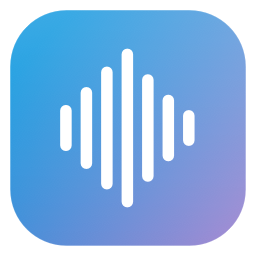

<p align="center"></p>
<h1 align="center">NoType</h1>
<p align="center">想到什么，就说出来。把口述变成能直接发送的文字。</p>

NoType 是原生 macOS 语音输入应用：用快捷键开始口述，选择本地或云端语音识别，再按需交给 Codex CLI 清理口误、语气词与标点，最后输入到原来的输入框。

**当前版本：0.6.5 · Apple Silicon · macOS 14+ · 测试版**

[下载安装包](https://github.com/ssyxsec/NoType/releases/latest) · [使用手册](docs/user-guide.md) · [隐私与数据](docs/privacy.md) · [源码构建](docs/building.md)

## 功能

- **三种语音引擎**：Whisper 本地模型、Apple 设备端语音识别、自定义云端 API。
- **Codex 文字整理**：通过本机已登录的 Codex CLI 处理文本，支持自然表达、忠实原文、邮件与消息、翻译成英文。
- **自动输入**：记录口述前的应用与输入框，完成后自动粘贴；目标改变或权限不足时提示并回退复制。
- **自定义快捷键**：默认 `⌃⌥Space` 开始／结束录音，可在设置中修改。
- **持续状态浮窗**：显示录音、转写、Codex 整理与输入进度；macOS 26+ 使用原生 Liquid Glass，旧系统使用兼容外观。
- **历史与统计**：搜索和导出文字历史，查看口述字数、平均口述速度、口述时间、活跃天数和每日使用热力图。
- **个人词库**：为 Codex 整理提供常用专有名词与写作偏好。

## 安装与开始使用

1. 从 [Releases](https://github.com/ssyxsec/NoType/releases/latest) 下载 `NoType-0.6.5-macOS-arm64.zip`，解压后拖到“应用程序”。目前不提供 Intel 安装包。
2. 打开 NoType，按系统提示授予麦克风权限；在“系统设置 → 隐私与安全性 → 辅助功能”允许 NoType，供自动输入使用。
3. 进入设置，配置下面任意一种语音引擎。**安装包没有附带 Whisper 引擎、Whisper 模型或 Codex CLI。**
4. 若需要文字优化，安装并登录自己的 Codex CLI；不需要时关闭“Codex 整理”。
5. 把光标放到目标输入框，按 `⌃⌥Space` 说话，再按一次结束，等待结果输入。

当前安装包使用本地开发证书签名，**尚未取得 Apple Developer ID 签名和公证**，首次打开可能受到 Gatekeeper 拦截。请先核验下载来源；系统提供的“仍要打开”入口见使用手册。不要通过关闭系统安全保护来安装。

## 选择语音引擎

| 引擎 | 初次准备 | 音频去向 | 适合情况 |
| --- | --- | --- | --- |
| Whisper | 安装 whisper.cpp 和模型 | 本机处理 | 希望音频留在本机 |
| Apple | 开启听写、授予语音识别权限，语言需支持设备端识别 | 请求设备端处理，不自动回退云端 | 希望使用系统能力 |
| 云端 API | 配置自己的服务地址、模型和 API Key | 上传到所选服务商 | 已有千问等语音 API |

### Whisper

需先安装 [Homebrew](https://brew.sh/)，然后在源码目录运行：

```sh
bash scripts/install-whisper.sh
```

脚本安装 whisper.cpp，下载并校验 small 多语言模型（约 465 MiB）。设置中填写脚本输出的引擎与模型路径；模型默认保存在 `~/Library/Application Support/NoType/Models/ggml-small.bin`。模型运行会占用本机内存与计算资源，速度取决于设备和录音长度。

### Apple

在“系统设置 → 键盘 → 听写”中开启听写并选择语言，再允许 NoType 的语音识别权限。系统不支持所选语言的设备端识别时，可切换 Whisper 或云端 API。

### 千问与其他云端服务

在设置中选择“云端 API · 自定义”，千问可使用北京／新加坡预设，填写对应地域的 Key 和 `qwen3-asr-flash` 模型。API Key 只保存在 macOS 钥匙串中，安装包不包含任何人的 Key。

也支持通用 `multipart /audio/transcriptions` 协议。不同服务商的模型与接口并非通用，详见[配置步骤](docs/user-guide.md#云端语音-api)。云端识别消耗你自己的服务商额度。

## Codex 整理如何工作

NoType **不使用 Codex 直接识别音频**。它先由所选语音引擎得到文字，再通过 `codex app-server` 请求文字整理。启用后，转写文本、个人词库和写作偏好会发送给 Codex 服务。

请按 [Codex CLI 官方说明](https://developers.openai.com/codex/cli/)安装，并使用自己的 ChatGPT 账号登录。NoType 当前仅接受 CLI 返回的 ChatGPT 登录类型，不使用 API Key 登录作为计费回退；账号可用性和额度由服务决定。模型列表动态读取当前电脑所配置的 CLI，不写死某个账号的型号。

“自然表达”清理无实义的填充语、重复、明确的自我纠正并整理标点；“忠实原文”主要保留原措辞。不能确定的名字、数字与事实仍需自行核对。整理任务禁用工具和 MCP，按纯文本转换运行。

整理上限为 20 秒，可随时点“立即使用原文”。开启超时回退后，超时直接使用转写原文，结果下方会明确标注未完成整理；不会把原文回退显示为 Codex 成功。

## 数据与限制

- 历史、偏好及词库保存在本机；API Key 保存在系统钥匙串。分享应用不会携带自己的配置与登录。
- 成功录音会清理；识别失败时暂存供重试，开始新录音、放弃或退出时清理。导入的原始文件保留。
- 云端模式在结束录音后上传整段音频，当前不是边说边识别。网络请求上限 45 秒，转换上限 15 秒；不自动发起付费重试。
- 自动输入依赖辅助功能权限和目标应用支持，部分安全输入框不可用。
- 无自动更新功能。更换签名身份或自行构建后，macOS 可能要求重新授予权限。

## 开发

SwiftUI / AppKit + Swift Package Manager，应用无 Swift 第三方包依赖。详见[构建文档](docs/building.md)。

```sh
swift test
./scripts/build.sh
```

0.6.5 已通过 31 项自动测试，覆盖云端请求／解析／超时／取消、Codex 协议与隔离、历史、统计和快捷键逻辑。真实麦克风、第三方应用输入和供应商延迟仍会受运行环境影响。

## 反馈

请在 [Issues](https://github.com/ssyxsec/NoType/issues) 提供 macOS 版本、NoType 版本、所选引擎、复现步骤及脱敏截图。**不要上传 API Key、Codex 登录文件、个人录音或未经脱敏的历史。**

NoType 是独立项目，与 Typeless、Apple、OpenAI 或阿里云不存在隶属或官方合作关系。本仓库尚未指定开源许可证。
